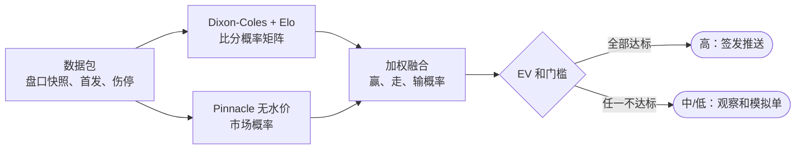

# 先知 · 准确率升级路线图

> 准确率取决于信息源质量和模型算法，两者都要用历史数据和每天的回测来验证。这一页给出现状评估、模型设计、验证机制、可借鉴的做法、爬虫补充、多智能体分工和分阶段路线。

## 目录

1. [结论](#1-结论)
2. [信息源质量](#2-信息源质量)
3. [爬虫补充数据源](#3-爬虫补充数据源)
4. [模型设计](#4-模型设计)
5. [历史数据与每日验证](#5-历史数据与每日验证)
6. [怎么判断真的变准了](#6-怎么判断真的变准了)
7. [可借鉴的项目与方法](#7-可借鉴的项目与方法)
8. [多智能体分工](#8-多智能体分工)
9. [分阶段路线图](#9-分阶段路线图)
10. [需要你决定或花钱的事](#10-需要你决定或花钱的事)
11. [参考资料](#11-参考资料)

## 1. 结论

> **三件最重要的事**
>
> 以 Pinnacle 无水价作为市场基准，只在我们的价格更好、模型也同意时才推荐；每场筛选比赛都记录收盘线并做模拟单，用 CLV 而不是几场命中率来判断有没有优势；在 Dixon-Coles + Elo 模型通过滚动验证之前，信心等级仍以市场信号为主。

现在只有 2 条推荐（1 条赛前撤销，波尔图待结算），任何命中率都还没有意义。所以第一步不是“预测得更准”，而是把每场比赛的数据完整记下来，让以后的判断有据可查。

## 2. 信息源质量

| 数据源 | 强项 | 短板 | 改进 |
|---|---|---|---|
| API-Football（免费） | 赛程、首发、交锋；10 家亚盘（含 Pinnacle、SBO、Bet365） | 每天 100 次；免费档拿不到当季积分/球队统计；亚洲联赛伤停为空；首发开赛前 20–40 分钟才有 | 首发复核时优先用；升 Pro（$19/月）可解锁当季和历史 |
| The Odds API（免费） | 8 家欧洲公司含 Pinnacle，主盘稳定 | 每月 500 credits；不含亚冠、卡塔尔；每家只给一条主盘；历史接口要付费 | 只在开盘和临场两个时点各拉一次，省额度 |
| OddsPapi（免费） | 366 家，含 Pinnacle、SBO、Singbet、PS3838、Saba，亚洲盘最全；历史赔率接口免费 | 每月 250 次；历史接口实测遇到 429 | 历史接口加节流重试，用来回填收盘线；亚冠和卡塔尔以它为主 |
| football-data.org | 欧洲积分榜、近况、交锋；第二比分源 | 没有亚洲联赛；每分钟 10 次 | 只在欧洲联赛用，作结算交叉核对 |
| 5DollarFootballAPI（免费） | 五大联赛 Bet365 亚盘初盘到收盘 | 只有五大联赛、只有 Bet365；公开展示必须署名 | 可申请 Community（$0）加一个亚洲国家包 |
| 球探 titan007 goal3.xml | 亚洲盘口初盘和即时盘、港盘水位，覆盖面广 | 非官方；其 robots.txt 禁止抓取 /vbsxml/ 和带 ? 的地址，我们现在用的正是这类地址；vip、zq 子站连不上；无 SLA | 降级为参考源，不再作推荐盘口的唯一依据；用 OddsPapi 的亚洲公司盘口替代 |

- 缺口一：亚洲联赛没有可靠 xG。FBref 已于 2026-01-20 失去 Opta 高级数据，Understat 只覆盖欧洲联赛；FotMob 网页上能看到 J1、K1 的 xG，但没有官方 API。
- 缺口二：首发太晚。API-Football 的首发要到开赛前 20–40 分钟，早上 10 点的日报只能估计。
- 缺口三：收盘线没有系统记录。没有收盘线就算不了 CLV，也就无法快速判断判断力。
- 缺口四：球探是非官方来源，且其 robots.txt 不允许抓取我们正在用的地址，必须降级。
- 缺口五：免费额度紧，每天要把调用集中在开盘、日报、临场三个时点。

## 3. 爬虫补充数据源

原则：有官方 API 或官方账号就不抓网页；robots.txt 或使用条款不允许的就不抓；抓到的数据只作补充，必须和 API 交叉核对。以下 robots.txt 结果是 2026-11-04 从服务器实测。

（原页面可按类别筛选，此处按类别全部展开。）

### 类别：官方首发和球队新闻

| 来源 | 补充什么 | 时效 | 难度 | 稳定性 | robots.txt / 条款 |
|---|---|---|---|---|---|
| J.League 官网 jleague.jp | J1/J2 官方首发、伤停公告、比分 | 首发开赛前公布 | 低：静态 HTML | 高 | robots.txt 只禁 2010 年代旧比赛页等，比赛页可抓 |
| K League kleague.com / data.kleague.com | K1 官方首发和数据 | 首发开赛前公布 | 中 | 中 | data.kleague.com 的 robots.txt 为 Disallow: /，不抓；主站无 robots.txt，需读条款 |
| AFC 官网 the-afc.com | 亚冠精英、亚冠二级官方首发和赛况 | 赛前公布 | 中：页面较重 | 中 | robots.txt 全部允许，附 sitemap |
| A-Leagues aleagues.com.au | 澳超首发、队伍新闻 | 赛前公布 | 低 | 中 | robots.txt 只禁后台和分享参数 |
| 沙特联 spl.com.sa | 沙特联赛程、首发 | 赛前公布 | 中 | 中 | robots.txt 允许，只禁后台路径 |
| 中超、卡塔尔联赛官网 | 官方赛程和首发 | 未知 | 未知 | 未知 | 本次从服务器连不上，需用浏览器再测 |
| 俱乐部官方 X 账号 | 首发图、临场伤停、主帅发布会 | 多数俱乐部赛前发首发（时间需实测） | 低：用已接入的 X 读取工具 | 高 | 走官方工具，不抓网页；只读不转载图片 |

### 类别：盘口比较

| 来源 | 补充什么 | 时效 | 难度 | 稳定性 | robots.txt / 条款 |
|---|---|---|---|---|---|
| 球探详情页 vip/zq.titan007.com | 按公司的初盘、收盘、变盘明细 | 实时 | 高：连接被拒 | 低 | robots.txt 禁止 /detail/ 和带参数页；不建议抓，用 OddsPapi 历史接口替代 |
| OddsPortal oddsportal.com | 多公司亚盘、收盘 | 实时 | 高：JS 动态加载，需浏览器 | 低 | robots.txt 禁 ajax-widget、feed；条款未核实，不作主源 |

### 类别：xG 和技术统计

| 来源 | 补充什么 | 时效 | 难度 | 稳定性 | robots.txt / 条款 |
|---|---|---|---|---|---|
| FotMob fotmob.com | J1、K1 等亚洲联赛 xG（网页可见） | 赛后 | 中：Next.js 页面 | 中 | robots.txt 禁止 /api/*，只能读普通网页；无官方 API |
| Understat understat.com | 五大联赛等 xG、射门 | 赛后 | 低：页面内嵌 JSON | 高 | 无 robots.txt；只覆盖欧洲联赛 |
| FBref fbref.com | 历史基础数据 | 赛后 | 高：Cloudflare 403 | 低 | 2026-01-20 起已无 Opta 的 xG；每分钟超 10 次会被封；条款禁止用其数据做竞争性数据库 |
| Sofascore sofascore.com | 多联赛 xG、评分 | 赛中/赛后 | 高：robots.txt 也返回 403 | 低 | 反爬强，不建议 |

### 类别：伤停和新闻

| 来源 | 补充什么 | 时效 | 难度 | 稳定性 | robots.txt / 条款 |
|---|---|---|---|---|---|
| Transfermarkt transfermarkt.com | 伤停名单、停赛 | 每日 | 中 | 中 | robots.txt 允许，但使用条款明确禁止机器人和抓屏，不抓 |
| 当地媒体和赛前预览（Sports Mole、Football Italia 等） | 伤停、预计首发、战意 | 赛前 1–2 天 | 低：通过搜索读取 | 中 | 只摘要、注明出处链接，不整篇复制 |

### 类别：天气和球场

| 来源 | 补充什么 | 时效 | 难度 | 稳定性 | robots.txt / 条款 |
|---|---|---|---|---|---|
| Open-Meteo api.open-meteo.com | 开赛时段降雨、气温、风速 | 每小时 | 低：官方免费 API | 高 | 非商业免费，每天 1 万次；若 VIP 收费即属商业用途，需付费档 |
| 球场坐标（API-Football venues） | 球场位置、草皮 | 静态 | 低 | 高 | 已接入的 API，缓存永久 |

### 合规、稳定的抓取方案

1. **先看规则**：每个站点上线前记录 robots.txt 和条款结论，写进 `config/sources.yaml`；不允许的站点不接。
2. **限速和缓存**：每个域名每分钟不超过 6 次（FBref 类站点更低）；页面缓存，带 ETag / If-Modified-Since 条件请求，没变化就不重抓。
3. **重试和退避**：429、5xx 按指数退避重试 3 次，尊重 Retry-After；不换 IP、不用代理绕过限制。
4. **礼貌的 User-Agent**：固定 UA，写明项目名和联系邮箱，不伪装成浏览器。
5. **结构校验**：解析结果过 JSON Schema（`schema/` 目录），首发必须 11 人、球员名能对上别名表，否则视为解析失败。
6. **变更检测和告警**：页面结构哈希变化或连续 2 次解析失败，数据官当天在 Telegram 私信告警，数据源状态页标红。
7. **交叉核对**：首发、比分、盘口至少 2 个来源一致才采用；不一致就标记“待核”，不进入推荐。

### 和 API 怎么互补

- 首发复核：官网或俱乐部 X 的首发通常比 API-Football 更早，可以把临场复核提前，并与 API 首发核对。
- 亚洲公司收盘线：用 OddsPapi 历史接口（免费）记录 SBO、Singbet、Pinnacle 的收盘，替代球探详情页。
- 亚洲联赛 xG：FotMob 网页限速读取 J1、K1 的球队 xG，作为模型特征，不单独决定推荐。
- 天气：Open-Meteo 按球场坐标取开赛时段降雨和风速，暴雨、强风时下调大比分概率。

## 4. 模型设计

文字流程：数据包（盘口快照、首发、伤停）分别进入 Dixon-Coles + Elo（比分概率矩阵）和 Pinnacle 无水价（市场概率）→ 加权融合（赢、走、输概率）→ EV 和门槛判断：全部达标 → 高：签发推送；任一不达标 → 中/低：观察和模拟单。

### 第一阶段：规则打分（现在）

- 保留现有 `analyze.py` 的因子打分，但加三条硬门槛：价格不低于 Pinnacle 无水价、走势不反向、盘口在 -1 到 +1。
- 每个因子是否成立都记下来，回测时看哪些因子真的有用。
- 盘口和多家中位数相差超过 0.25 降级，超过 0.5 撤下（已上线）。

### 第二阶段：统计模型

- Dixon-Coles：每队攻防参数、主场优势、低比分修正，按时间衰减加权近期比赛。
- Elo（ClubElo 已覆盖 J1、K1、中超、沙特、卡塔尔、澳超）作先验，补足样本少的球队。
- 从比分概率矩阵直接算任意亚盘的赢、走、输概率，所有盘口口径一致。
- 和市场概率加权融合，权重用滚动验证的 log loss 来定。

### 关键公式

去掉抽水的公平概率（按比例法，另有 power、Shin 等方法可比较）：

$$p_{主} = \frac{1 / o_{主}}{1 / o_{主} + 1 / o_{客}}$$

融合概率，w 初始取 0.25（以市场为主），之后由滚动验证校准：

$$p = w \cdot p_{模型} + (1 - w) \cdot p_{市场}$$

四分之一盘拆成两个相邻盘口各半注，例如 -0.75 = 一半 -0.5 + 一半 -1；-1 时净胜 1 球为走盘。期望收益：

$$EV = \frac{EV(L_1) + EV(L_2)}{2}, \quad EV(L) = p_{赢} \cdot (o - 1) - p_{输}$$

收盘线价值（同一盘口下比较；收盘盘口变了，就用模型把收盘价换算到我们的盘口）：

$$CLV = \frac{下注赔率}{收盘无水公平赔率} - 1$$

### 信心等级映射（初始值，300 场模拟单后重新校准）

| 等级 | 条件 | 处理 |
|---|---|---|
| 高 | 融合 EV ≥ +3%；价格不低于 Pinnacle 无水价；模型与市场同向；走势不反向；盘口 -1 到 +1；联赛处于“主推”；关键字段两源一致 | 签发推送，每天最多 3 场 |
| 中 | EV +1% 到 +3%，或缺一项条件 | 观察名单 + 模拟单，不推送 |
| 低 | EV < +1% 或数据不全 | 只做模拟单 |

## 5. 历史数据与每日验证

### 每场要存什么

- 开盘和收盘：各家公司盘口、水位、抓取时间
- Pinnacle 无水公平价（开盘、日报时、临场、收盘）
- 特征：Elo、近况、伤停、首发变化、赛程密度、天气
- 模型版本、模型概率、融合概率、EV
- 决定：推荐、观察或放弃，以及原因
- 结果：比分（两个来源）、亚盘结算、单位盈亏、CLV

### 历史回填

- football-data.co.uk 欧洲主要联赛 CSV：有亚盘盘口 AHh、Pinnacle 亚盘水位 PAHH/PAHA，以及收盘 AHCh、PCAHH/PCAHA、平均收盘 AvgCAHH。
- 日本、中国等“额外联赛”CSV 只有 1X2 收盘（PSCH、AvgCH、B365CH），没有亚盘；用 1X2 收盘反推进球期望，再换算亚盘公平线。注意：2026 赛季 J1 和中超的 Pinnacle 收盘列为空，只能用平均收盘。
- 韩国、澳超、沙特、卡塔尔不在该数据集内，靠 OddsPapi 历史接口和 API-Football 2022–2024 赛季比分补。

### 每日和定期机制

1. **每天：所有筛选场次做模拟单**：不只是推荐的场次，每场按模型首选方向、1 单位记账，赛后自动结算并记录 CLV。
2. **每周：复盘报告**：命中率、单位盈亏、平均 CLV、Brier 和 log loss，按联赛和盘口深度拆开；列出判断错的场次和原因。
3. **每月：模型复审**：滚动重新拟合，样本外比较新旧版本；只在新版本更好时替换。
4. **升降级**：联赛或盘口类型满 100 场模拟单且平均 CLV > 0 才能升为“主推”；满 100 场 CLV < 0 或 200 场收益率明显为负就降为“只观察”。

## 6. 怎么判断真的变准了

| 收益率 | 平均赔率 | 需要的场数（单边 p≈0.01，估算） |
|---|---|---|
| 10% | 2.00 | 约 540（Buchdahl 原文） |
| 10% | 1.90 | 约 490 |
| 5% | 1.90 | 约 1950 |
| 3% | 1.90 | 约 5400 |

- 按每天最多 3 场，要证明 3% 左右的优势需要好几年，所以不能只看命中率。
- CLV 收敛快得多：Buchdahl 的“群体智慧”系统近 2 万注，预期收益 4.0%，实际 3.4%。
- 概率质量用 Brier、log loss 或 RPS 评估，和 Pinnacle 收盘概率比，比它差就说明模型还不如市场。
- 防过拟合：只用滚动（walk-forward）验证，参数和阈值只看历史，测试期不回头调；每加一个规则都要记录。

## 7. 可借鉴的项目与方法

| 项目或方法 | 做了什么 | 我们借鉴什么 |
|---|---|---|
| penaltyblog（Python 开源） | Poisson、双变量 Poisson、Dixon-Coles、贝叶斯模型；Elo、pi-ratings；去抽水；四分之一盘赢走输概率 | 直接作为第二阶段的模型库 |
| soccerdata（Python 开源） | ClubElo、Understat、Sofascore 等数据的统一读取，内置限速 | 抓取层的限速和缓存设计 |
| Dixon & Coles（1997） | 时间衰减 Poisson + 低比分修正，并在博彩市场检验 | 模型主体 |
| pi-ratings（Constantinou & Fenton 2013） | 基于净胜球误差的动态评分，区分主客场 | Elo 的替代或补充特征 |
| BeatTheBookie（Kaunitz 等 2017） | 用多家公司平均赔率找偏离的价格，模拟和实盘都盈利，之后账户被限 | 多源共识：偏离共识的价格才有价值 |
| Buchdahl / football-data.co.uk | Pinnacle 收盘高度有效；CLV 预测长期收益 | 以 Pinnacle 无水价为基准，CLV 作主指标 |
| RebelBetting、Trademate | 以 Pinnacle 去水价为公平价，找软公司高赔率 | 发布门槛：价格不低于公平价 |
| Pinnacle Odds Dropper | 监控 Pinnacle 短时急跌（steam），记录 CLV | 临场资金流信号和公开 CLV 记录 |
| Hubáček 等（2019） | 模型故意与博彩公司赔率去相关，才能找到优势 | 只在模型和市场有分歧时出手 |

## 8. 多智能体分工

（原页面可按角色切换，此处全部展开。）

### 先知（主控）

| 项目 | 内容 |
|---|---|
| 职责 | 汇总各方结果，执行发布规则，最终签发推荐、保留或撤销 |
| 输入 | 数据官的已核对数据包、模型研究员的概率和 EV、回测审计员的联赛状态 |
| 输出 | 当日报告 JSON 和 MD、赛前确认结论、对用户的说明 |
| 负责路径 | `config/settings.yaml`（policy 段）、`src/ah/policy.py`、`reports/` |
| 验收标准 | 每条推荐都过两道关卡；没有理由的推荐一律不发 |

### 数据官

| 项目 | 内容 |
|---|---|
| 职责 | API 和爬虫采集、多源核对、额度监控、解析失败告警 |
| 输入 | 5 个 API、官网和 X 首发、天气 |
| 输出 | 每场一份数据包：盘口快照（各家、时间戳）、首发、伤停、核对结果 |
| 负责路径 | `src/ah/api_football.py`、`odds_api.py`、`oddspapi.py`、`football_data.py`、`fivedollar.py`、`consensus.py`、`enrich.py`、`fetch_*.py`、`source_status.py`；新建 `src/ah/scrapers/`、`data/snapshots/` |
| 验收标准 | 关键字段至少 2 个来源一致，否则标记；额度余量不低于预留；解析器出错当天告警 |

### 模型研究员

| 项目 | 内容 |
|---|---|
| 职责 | 建立和迭代模型，滚动（walk-forward）验证，校准信心阈值 |
| 输入 | 历史比分和收盘线、数据包 |
| 输出 | 每场公平亚盘、赢走输概率、EV、模型版本号 |
| 负责路径 | `src/ah/analyze.py`；新建 `src/ah/model/`、`data/history/`、`docs/model.md` |
| 验收标准 | 新版本必须在样本外 log loss 不差于旧版和市场基线才上线 |

### 回测审计员

| 项目 | 内容 |
|---|---|
| 职责 | 独立结算、所有筛选场次的模拟单、CLV 和 Brier、每周复盘 |
| 输入 | 比分（两个来源）、收盘线、当日报告、模拟单 |
| 输出 | 结算记录、战绩统计、周报和月报、联赛升降级建议 |
| 负责路径 | `src/ah/settle.py`、`stats.py`、`records.py`、`data/predictions.csv`、`data/stats.json`；新建 `data/paper_trades.csv`、`reports/reviews/` |
| 验收标准 | 结算两源比分一致才落账；不参与选场，只核账 |

### 产品工程师

| 项目 | 内容 |
|---|---|
| 职责 | 网站看板、Telegram 推送和菜单、仓库、CI 和测试 |
| 输入 | 签发后的报告、统计、数据源状态 |
| 输出 | 网站页面、推送消息、通过的测试 |
| 负责路径 | `src/ah/build_site.py`、`publish_telegram.py`、`tg_bot.py`、`render_report.py`、`templates/`、`site/`、`.github/workflows/`、`tests/` |
| 验收标准 | 测试全过才合并；推送失败自动重试并告警；网站数据和报告一致 |

### 每日流程（北京时间）

1. **08:30 数据官采集**：拉赛程和开盘快照，做两源核对，输出数据包和额度报告。
2. **09:00 模型研究员计算**：对所有筛选场次出公平盘口、概率和 EV。
3. **09:30 第一道关卡：数据与模型核对**：数据官确认关键字段两源一致；模型研究员确认 EV 和门槛；任一不过就进观察名单。
4. **10:00 先知签发日报**：只发高信心场次；产品工程师推送 Telegram 并更新网站。
5. **开赛前 60 分钟 第二道关卡：临场复核**：数据官取官方首发和临场盘口；模型重算；先知决定保留、调整或撤销。
6. **赛后 回测审计员结算**：两源比分一致才落账；所有模拟单一并结算，更新 CLV 和统计。
7. **每周一 回测审计员周报**：提出联赛升降级建议，由先知批准后改配置。

## 9. 分阶段路线图

（原页面可按阶段切换，此处全部展开。）

### 阶段：本周

**交付内容 · 本周**

1. 发布门槛：推荐价不低于 Pinnacle 无水公平价，盘口走势不反向，盘口限 -1 到 +1
2. 每场记录开盘、收盘、各家盘口，赛后算 CLV（数据官 + 回测审计员）
3. 所有筛选场次做模拟单（不推送），每天自动结算
4. 首发公布后临场复核：赛前确认从 50 分钟改为 60 分钟，加一次首发后复核
5. 抓取框架：统一限速、缓存、重试、解析失败告警；先接 J.League 和俱乐部 X
6. 多智能体分工落地：数据官、回测审计员先上岗

**投入、依赖与标准**

| 项目 | 内容 |
|---|---|
| 投入 | 2–3 天开发，全部用现有免费额度 |
| 依赖 | OddsPapi 历史接口（节流）、football-data.co.uk CSV、ClubElo |
| 成功标准 | 每场筛选比赛都有开盘、收盘、无水公平价、模拟单；网站显示 CLV |
| 需你决定 | 是否同意把球探降为参考源（它的 robots.txt 不允许我们现在的抓法） |

### 阶段：2–4 周

**交付内容 · 2–4 周**

1. Dixon-Coles + Elo 模型，输出公平亚盘和赢、走、输概率（模型研究员）
2. 回填欧洲主要联赛历史亚盘和收盘线；亚洲联赛用 1X2 收盘反推
3. 模型和 Pinnacle 无水概率加权融合，按 EV 定信心等级
4. 每周复盘报告自动生成，网站加“模型 vs 市场”页
5. 抓取扩展到 AFC、A-Leagues、沙特联官网；天气接入 Open-Meteo

**投入、依赖与标准**

| 项目 | 内容 |
|---|---|
| 依赖 | football-data.co.uk 历史 CSV；API-Football 免费档 2022–2024 赛季 |
| 成功标准 | 滚动验证中模型的 log loss 低于“只用市场价”基线；模拟单 ≥ 300 场 |
| 需你决定 | 是否开 API-Football Pro（$19/月）补当季数据 |

### 阶段：1–3 个月

**交付内容 · 1–3 个月**

1. 按联赛和盘口类型的升降级规则自动执行
2. 加入 xG（欧洲用 Understat，亚洲用 FotMob 网页，限速读取）
3. 资金流信号：多家亚洲公司同时降水、Pinnacle 急跌（steam）作为加分项
4. 赛程密度、亚冠长途飞行、主帅更换等特征进入模型

**投入、依赖与标准**

| 项目 | 内容 |
|---|---|
| 依赖 | 累计 1000+ 场模拟单；可选 5Dollar Ultra 或 OddsPapi 付费档 |
| 成功标准 | 模拟单平均 CLV > 0 且显著；各联赛升降级有数据支撑 |
| 需你决定 | 是否买 5Dollar Ultra（$25/月，20 家公司含 Pinnacle，2014 年起逐笔变盘） |

### 阶段：更长期

**交付内容 · 更长期**

1. 分层贝叶斯模型，处理升班马和样本少的联赛
2. 用球员级数据估计伤停对进球期望的影响
3. 和市场去相关的模型（只在模型与市场分歧处找机会）
4. 公开完整推荐与模拟单的长期记录，包括 CLV 曲线

**投入、依赖与标准**

| 项目 | 内容 |
|---|---|
| 投入 | 视数据而定 |
| 依赖 | 2000+ 场样本；稳定的付费赔率源 |
| 成功标准 | 实盘推荐的收益率在统计上显著为正 |
| 需你决定 | 是否引入付费 xG 或事件数据 |

## 10. 需要你决定或花钱的事

| 事项 | 价格（官网或公开页，2026 年） | 带来什么 | 建议 |
|---|---|---|---|
| 球探降为参考源 | 免费 | 合规；推荐盘口改用多家 API | 建议马上做 |
| 5Dollar Community Access | $0，12 个月可续 | 五大联赛 + 一个国家包，每小时 300 次，12 个月历史 | 建议，选日本 |
| API-Football Pro | $19/月，每天 7500 次 | 当季积分、球队统计、全部历史赛季 | 2–4 周时开 |
| The Odds API 20K | $30/月，2 万 credits；历史接口按 10 倍计 | 更多临场快照和历史 | 暂不需要 |
| OddsPapi 付费 | RapidAPI 列价 $19/月 1 万次、$49/月 5 万次（官网为自定义报价） | 亚洲公司临场多次快照 | 模拟单满 300 场后再看 |
| 5Dollar Ultra | $25/月（年付 $250） | 20 家公司含 Pinnacle，2014 年起逐笔变盘 | 1–3 个月阶段考虑 |
| Open-Meteo 商业档 | 免费档仅限非商业 | 若 VIP 收费需付费 | VIP 收费前再定 |

> ⚠️ **不确定的地方**
>
> 上面的门槛和权重都是初始值，要靠模拟单校准；亚洲联赛历史亚盘数据最少，模型在这些联赛会更不准；任何模型都可能长期跑不赢市场，到时候应该减少推荐甚至停推，而不是放宽标准。

## 11. 参考资料

- [Dixon & Coles (1997) Modelling Association Football Scores](https://doi.org/10.1111/1467-9876.00065)（doi.org）
- [Dixon-Coles 模型（R 教程）](https://opisthokonta.net/?p=890)（opisthokonta.net）
- [penaltyblog](https://github.com/martineastwood/penaltyblog/)（github.com）
- [penaltyblog 亚盘概率（含四分之一盘）](https://penaltyblog.readthedocs.io/en/latest/models/football_prob_grid.html)（readthedocs.io）
- [Pi-ratings (Constantinou & Fenton 2013)](http://www.constantinou.info/downloads/papers/pi-ratings.pdf)（constantinou.info）
- [Using ELO ratings for match result prediction (Hvattum & Arntzen 2010)](https://doi.org/10.1016/j.ijforecast.2009.10.002)（doi.org）
- [RPS 评分规则 (Constantinou & Fenton 2012)](https://doi.org/10.1515/1559-0410.1418)（doi.org）
- [The Efficiency of the Pinnacle Closing Line](https://football-data.co.uk/blog/pinnacle_efficiency.php)（football-data.co.uk）
- [CLV demystified (Buchdahl)](https://www.pinnacleoddsdropper.com/blog/closing-line-value--clv-demystified-by-expert-joseph-buchdahl)（pinnacleoddsdropper.com）
- [Luck Versus Skill in Sports Betting](https://football-data.co.uk/blog/luck_skill_sports_betting.php)（football-data.co.uk）
- [Beating the bookies with their own numbers](https://arxiv.org/abs/1710.02824)（arxiv.org）
- [BeatTheBookie 代码](https://github.com/Lisandro79/BeatTheBookie/)（github.com）
- [Exploiting sports-betting market using ML (Hubáček 2019)](https://ida.fel.cvut.cz/papers/hubacek2019exploiting.html)（cvut.cz）
- [football-data.co.uk 字段说明](https://www.football-data.co.uk/notes.txt)（football-data.co.uk）
- [ClubElo](http://clubelo.com/)（clubelo.com）
- [soccerdata 数据源](https://soccerdata.readthedocs.io/en/latest/datasources/)（readthedocs.io）
- [FBref 数据更新（失去 Opta 高级数据）](https://www.sports-reference.com/blog/2026/01/fbref-stathead-data-update/)（sports-reference.com）
- [Sports Reference 爬虫限速政策](https://www.sports-reference.com/bot-traffic.html)（sports-reference.com）
- [FotMob J1 xG 表](https://www.fotmob.com/leagues/223/table/j-league?filter=xg)（fotmob.com）
- [Transfermarkt 使用条款](https://www.transfermarkt.com/intern/anb)（transfermarkt.com）
- [Open-Meteo 条款](https://open-meteo.com/en/terms)（open-meteo.com）
- [RebelBetting 价值投注原理](https://www.rebelbetting.com/valuebetting)（rebelbetting.com）
- [Pinnacle Odds Dropper](https://www.pinnacleoddsdropper.com/)（pinnacleoddsdropper.com）
- [API-Football 价格](https://www.api-football.com/pricing)（api-football.com）
- [The Odds API 价格](https://the-odds-api.com/)（the-odds-api.com）
- [OddsPapi 请求与额度](https://oddspapi.io/us/docs/requests-and-quota)（oddspapi.io）
- [5DollarFootballAPI 价格](https://5dollarfootballapi.com/pricing)（5dollarfootballapi.com）
